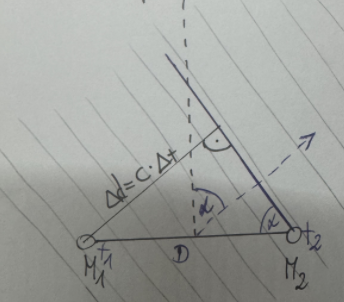

# Acoustic Direction-of-Arrival Sensor (ESP32)

Embedded system that estimates the **direction of an incoming sound** (e.g. a drone, vehicle or voice) from the time differences of arrival (TDOA) at a small array of synchronized MEMS microphones. Written in C on **ESP-IDF**, running on a classic **ESP32 (ESP-WROOM-32)**.

The scope of the project is **direction estimation only**: the system reports the angle the sound comes from, not the distance to the source.
Maybe in future I will cover the position of an object also.

A DHT11 sensor provides **ambient temperature compensation** of the speed of sound, which directly affects the computed angle.

> **Status:** work in progress. See [Roadmap](#roadmap) for what is implemented and what is planned.

---

## Table of contents

- [How it works](#how-it-works)
- [Hardware](#hardware)
- [Wiring](#wiring)
- [Software architecture](#software-architecture)
- [Building and flashing](#building-and-flashing)
- [Design decisions](#design-decisions)
- [Known issues and lessons learned](#known-issues-and-lessons-learned)
- [Limitations](#limitations)
- [Roadmap](#roadmap)
- [References](#references)

---

## How it works

### 1. Time difference of arrival

Sound travels at a finite speed `c`. A source that is not directly in front of a microphone pair reaches the nearer microphone first. The extra distance travelled to the second microphone is:

```
Δd = c · Δt
```

`Δt` is measured by cross-correlating the two microphone signals. The emission time of the sound is unknown, but it cancels out because only the **difference** of arrival times is used.

### 2. From delay to angle (two microphones)

For a distant source the wavefront is approximately planar. The microphone spacing `D`, the extra path `Δd` and the wavefront form a right triangle, which gives:

```
sin α = Δd / D = c · Δt / D        →        α = arcsin(c · Δt / D)
```

where `α` is the angle of arrival measured from broadside (perpendicular to the microphone axis).



Properties that follow directly from this relation:

| Property | Consequence |
|---|---|
| `\|Δt\| ≤ D / c` | Larger measured delays are physically impossible and are rejected as invalid. |
| `sin α = sin(180° − α)` | A single pair cannot distinguish front from back (±90° coverage only). |

### 3. Full 360° with three or more microphones

With microphones at known positions `Mᵢ` and an unknown unit direction vector `u = (cos θ, sin θ)`, every pair gives one linear equation:

```
−(Mⱼ − Mᵢ) · u = c · Δtᵢⱼ
```

Two independent pairs give a 2×2 linear system for `u`; the azimuth is `θ = atan2(u_y, u_x)`, covering the full circle. A third pair over-determines the system and is used as a consistency check (e.g. rejecting estimates corrupted by reflections).

### 4. Temperature compensation

The speed of sound in air depends on temperature:

```
c(T) ≈ 331.3 + 0.606 · T   [m/s],   T in °C
```

| Temperature | c |
|---|---|
| −10 °C | ~325 m/s |
| 0 °C | ~331 m/s |
| 20 °C | ~343 m/s |
| 35 °C | ~353 m/s |

A fixed `c = 343 m/s` introduces a systematic error of several percent in `c · Δt / D` outdoors. The DHT11 reading is used to update `c` at runtime.

---

## Hardware

| Component | Qty | Notes |
|---|---|---|
| ESP32 DevKit (ESP-WROOM-32) | 1 | Dual-core, two I2S peripherals |
| INMP441 MEMS microphone module | 2–4 | Digital I2S, 24-bit, SNR 61 dBA, omnidirectional, bottom port |
| DHT11 temperature/humidity sensor | 1 | Speed-of-sound compensation |
| Breadboard + jumper wires | — | Prototype stage |
| Rigid mounting plate | 1 | Fixes microphone geometry (planned) |

Optional / planned: WS2812 LED ring or 28BYJ-48 stepper (with ULN2003) as a direction indicator.

---

## Wiring

### Current configuration: two microphones, one per I2S peripheral

Both microphones transmit in the **left** I2S slot (`L/R` tied to GND). Each has its own data line and its own I2S peripheral; both share one clock generated by the master.

| INMP441 pin | Mic A | Mic B | Function |
|---|---|---|---|
| VDD | 3V3 | 3V3 | Supply (3.3 V only) |
| GND | GND | GND | Ground |
| SCK | GPIO26 | GPIO26 | Bit clock, driven by I2S0 (master) |
| WS | GPIO25 | GPIO25 | Word select / LR clock, driven by I2S0 |
| SD | **GPIO34** → I2S0 | **GPIO35** → I2S1 | Serial data out |
| L/R | GND | GND | Left slot |

```
```
Spacing is chosen as a trade-off (see [Design decisions](#design-decisions)). Microphone positions are measured between **acoustic ports** (the hole in the PCB), not module edges, to ±1 mm; the exact coordinates are what the software uses, so the shape does not need to be perfect, only known.

```

### I2S configuration

| Parameter | Value | Reason |
|---|---|---|
| Sample rate | 48 kHz | Delay resolution of ~20.8 µs per sample |
| Slot width | 32 bit | INMP441 requires 64 SCK cycles per WS frame |
| Data | 24 bit, MSB-aligned | Extracted with an arithmetic `>> 8` |
| Format | Philips (standard I2S) | Native INMP441 format |
| Slot mode | Stereo | Two microphones per data line in the full configuration |
| Roles | I2S0 master, I2S1 slave | Single clock source → sample-synchronous capture |

## Building and flashing

Requirements: ESP-IDF (v5.x or newer) with the environment exported in the current shell.

```bash
. $HOME/esp/esp-idf/export.sh      # adjust path to your ESP-IDF install
idf.py set-target esp32
idf.py build
idf.py -p /dev/ttyUSB0 flash monitor
```

`main/CMakeLists.txt` must declare the I2S driver dependency:

```cmake
idf_component_register(SRCS "main.c"
                       INCLUDE_DIRS "."
                       PRIV_REQUIRES esp_driver_i2s)
```

---

## Design decisions

### Microphone spacing

Two constraints pull in opposite directions:

- **Spatial aliasing (upper bound):** `D ≤ c / (2 · f_max)`. Above `f_max` the phase difference exceeds half a period and ghost directions appear.
- **Angular resolution (lower bound):** the full lag range is `D · fs / c` samples; smaller arrays have fewer samples to resolve the angle and weak phase differences at low frequencies.

| D | Max lag @ 48 kHz | Alias-free up to |
|---|---|---|
| 3 cm | ~4 samples | ~5.7 kHz |
| 5 cm | ~7 samples | ~3.4 kHz |
| 10 cm | ~14 samples | ~1.7 kHz |


### Microphone choice

INMP441 was chosen for cost and availability: digital output (no ADC skew), synchronous capture via a shared clock, and wide ESP32 support. Analog microphones with the ESP32 ADC, AGC modules (MAX9814) and threshold "sound sensor" boards (KY-037/038) are unsuitable for phase-based localization.


## References

- Espressif — *ESP-IDF Programming Guide: I2S (Inter-IC Sound)*.
- Espressif — *esp-dsp* library.

## License

- Project is distributed under MIT License.
